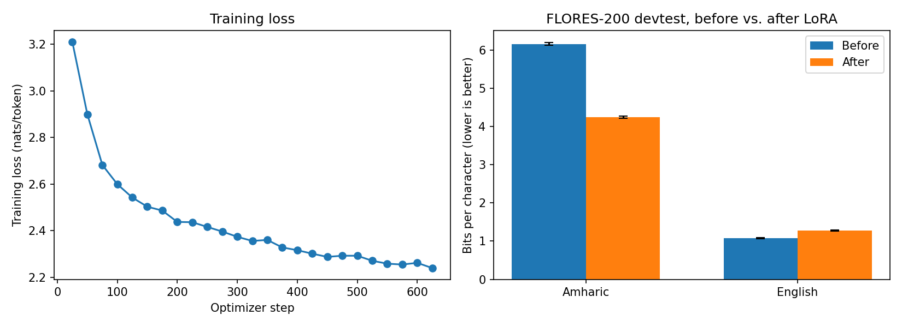

# LoRA adaptation of a small LM to Amharic

A small, fully reproducible experiment: how much does LoRA fine-tuning on a modest
amount of Amharic text improve a small open model on Amharic, and what does it cost
on English?

**Author:** Bedru Yimam Ahmed

## Result

| Model | Trainable params | Amharic bits/char (before → after) | English bits/char (before → after) | Training time |
|---|---|---|---|---|
| Qwen2.5-0.5B + LoRA (r=16) | 2.16M (0.44%) | 6.163 → 4.248 | 1.077 → 1.279 | 13 min on a Colab T4 |



Evaluated on FLORES-200 `devtest` (1,012 sentences per language). Lower is better.
95% CIs are from a paired bootstrap over sentences (2,000 resamples).

| Language | Change (bits/char) | Relative change | 95% CI (relative) |
|---|---|---|---|
| Amharic | −1.915 | **−31.1%** | [−31.4, −30.7] |
| English | +0.202 | **+18.8%** | [+18.2, +19.3] |

**Reading the result.**
- LoRA on ~1.8M Amharic tokens, training 0.44% of the weights for 13 minutes, cut
  Amharic bits per character by about 31%.
- English got worse by about 19%. The adapter was trained on Amharic only, with no
  English replay data, so this is a real cost of the setup rather than noise.
- Amharic remains well above English in absolute bits per character. Do not read that
  gap as "Amharic is 4x harder": bits per character is not directly comparable across
  languages and scripts. It is only comparable across models or tokenizers on the
  *same* text, which is how it is used here.

## Why bits per character, not perplexity

Perplexity depends on the tokenizer. Qwen2.5's tokenizer fragments Amharic heavily
(measured on FLORES-200 devtest):

| Language | Tokens per word | Characters per token | Tokens per byte |
|---|---|---|---|
| Amharic | 6.448 | 0.780 | 0.496 |
| English | 1.261 | 4.778 | 0.209 |

Because tokenizers differ so much on Amharic, per-token perplexity would not be a
fair basis for comparing models. Total negative log-likelihood divided by the number
of characters is.

## Setup

| | |
|---|---|
| Base model | `Qwen/Qwen2.5-0.5B` (not gated) |
| Training data | Amharic Wikipedia (`wikimedia/wikipedia`, `20231101.am`), paragraphs ≥ 40 chars and ≥ 60% Ge'ez script, deduplicated; 39,134 available, 10,000 sampled (seed 42) |
| Training tokens | 1.78M after truncating to 384 tokens (1,574 of 10,000 paragraphs were truncated) |
| LoRA | r = 16, α = 32, dropout 0.05, on `q_proj`, `k_proj`, `v_proj`, `o_proj` |
| Optimisation | AdamW, lr 2e-4, linear schedule with 5% warmup, 1 epoch, batch 4 × 4 accumulation, 625 steps, fp16 autocast with fp32 weights |
| Evaluation | FLORES-200 `devtest`, Amharic and English, same sentences before and after |
| Leakage check | Exact-match filter against FLORES sentences (removed 0 paragraphs) |
| Hardware | One Tesla T4 (Colab) |

## Run it

1. Open `lora_amharic_experiment.ipynb` in Colab (Runtime → Change runtime type → T4 GPU).
2. Run all cells. Expect roughly 15 minutes of GPU time with the default settings;
   lower `N_TRAIN` / set `N_EVAL` for a quick smoke test.

The notebook writes `results/lora_results.csv`, `results/lora_run_config.json`, and
`results/lora_before_after.png`. The committed CSV and figure are from the run shown
in the notebook. Package versions were not pinned; the run used the latest releases
available on Colab at the time (see `requirements.txt`).

## Limitations

- **Single run, single seed.** The bootstrap CIs capture variation across evaluation
  sentences only. They do not capture training variance, so they are narrower than the
  true uncertainty.
- **One tokenizer.** The tokenizer statistics above describe Qwen2.5's tokenizer only.
  No tokenizers were compared against each other in this experiment.
- **LoRA only.** No QLoRA run and no full fine-tuning baseline.
- **No English replay or regularisation control**, so the English degradation is
  measured but not diagnosed.
- **Leakage check is exact-match only.** Near-duplicates between Wikipedia and FLORES
  were not searched for.
- **Language-modelling metric only.** No downstream task (translation, QA,
  classification) was evaluated.

## Possible next steps

- QLoRA (4-bit base) at the same settings, to compare quality, memory, and speed.
- Compare tokenizer choices for Amharic: the base tokenizer vs. one extended with
  Ge'ez-script tokens, and/or another multilingual model with different Amharic
  fertility, all scored with the same bits-per-character protocol.
- English replay mix to reduce forgetting; multiple seeds.

## Files

```
lora_amharic_experiment.ipynb   full experiment, with saved outputs
results/lora_results.csv        before/after table with bootstrap CIs
results/lora_before_after.png   training loss + before/after bits per character
requirements.txt
```
